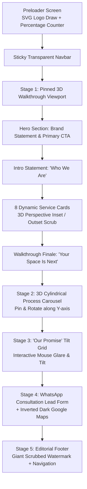

# UI/UX & Design Style Analysis: RAF Interiors India

This document presents a comprehensive design, architectural, and visual system analysis of **RAF Interiors India** ([rafinteriorsindia.com](https://www.rafinteriorsindia.com/)), alongside actionable guidelines for repurposing and customizing this layout for your own business.

---

## 1. Executive Summary & Aesthetic Classification

### Design Archetype: *Quiet Architectural Luxury & Editorial Dark Mode*
RAF Interiors employs an ultra-modern, high-contrast dark aesthetic that combines:
- **Haute Couture / High-End Studio Elegance**: Moody, deep oceanic blues paired with champagne golds and warm ivory cream typography.
- **Cinematic 3D Spatial Walkthrough**: Pinning the viewport while scroll progress guides the user through 3D room frames and perspective-shifted service cards.
- **Micro-Interaction Polish**: Kinetic custom cursors, film grain texture, cylindrical rotating 3D carousels, and mouse-reactive specular glares.
- **High-Velocity Lead Conversion**: Frictionless one-click WhatsApp routing and high-visibility telephone CTAs.

```
┌────────────────────────────────────────────────────────────────────────┐
│                          DESIGN DNA SNAPSHOT                           │
├───────────────────┬────────────────────────────────────────────────────┤
│ Aesthetic Category│ Editorial Dark Mode / High-End Turnkey Studio      │
│ Primary Palette   │ Deep Void Ink (#050b1a) + Champagne Gold (#e6c77a) │
│ Accent Palette    │ Warm Ivory (#f4eee2) + Midnight Navy (#0a1530)     │
│ Typography        │ Montserrat (Weights 300 to 900)                    │
│ Motion Stack      │ Lenis Smooth Scroll + GSAP ScrollTrigger + 3D CSS  │
│ Graphic Language  │ Hairline gold borders (1px), Frosted Glass (blur)  │
└───────────────────┴────────────────────────────────────────────────────┘
```

---

## 2. Color System & Chromatic Hierarchy

The color strategy uses a 60-30-10 distribution rule tailored for luxury digital experiences:
- **60% Dominant Base**: Deep midnight navy and ink shades (`--ink`, `--navy`) to create intimacy, depth, and remove visual noise.
- **30% Structure & Surfaces**: Navy gradients, translucent frosted glass (`--glass`), and muted ivory text (`--muted`).
- **10% High-Value Accents**: Warm metallic champagne gold (`--gold`, `--gold-hi`, `--gold-2`) reserved strictly for CTAs, stroke outlines, active room numbers, and primary branding.

### Exact Color Tokens (from `:root`)

| Variable Name | Hex Code | Purpose / Usage |
| :--- | :--- | :--- |
| `--ink` | `#050b1a` | Deepest foundation background, body background |
| `--navy` | `#0a1530` | Structural cards, section fills, mobile overlay |
| `--navy-2` | `#0f1e44` | Secondary card gradients, radial glow anchors |
| `--navy-3` | `#16295a` | Radial backdrop spotlight highlights, pill borders |
| `--gold` | `#e6c77a` | Primary brand gold, active dots, hover accents |
| `--gold-2` | `#c9a24f` | Gradient shadow tone for 3D metallic buttons |
| `--gold-hi` | `#f6e2a8` | Specular highlight for metallic gold buttons |
| `--cream` | `#f4eee2` | Primary headline typography, button hover fills |
| `--muted` | `#f4eee2a8` | Subtitles, body descriptions, secondary info (66% opacity) |
| `--line` | `#e6c77a42` | Hairline borders on cards, rings, and dividers (26% opacity) |
| `--glass` | `#08102694` | Translucent card fill under `backdrop-filter: blur(18px)` |

### Subtle Atmospheric Overlays
1. **Procedural SVG Film Grain**:
   ```css
   body:after {
     opacity: .045;
     background-image: url("data:image/svg+xml,...<filter id='n'><feTurbulence type='fractalNoise' baseFrequency='.9'.../></filter>...");
     animation: 1.2s steps(6, end) infinite grain;
   }
   ```
   *Why it matters*: Eliminates sterile digital color banding on OLED screens, introducing an analog, tactile architectural texture.

2. **Specular Glare Tracking**:
   ```css
   radial-gradient(circle at var(--gx, 50%) var(--gy, 0%), #e6c77a38, transparent 45%)
   ```
   *Why it matters*: Follows the visitor's cursor across cards to simulate real polished stone or brushed brass reflecting a directional gallery light.

---

## 3. Typography System

The website relies on a single high-performance geometric font family: **Montserrat**.

### Typographic Hierarchy & Scale

```
┌───────────────────────────┬─────────────┬────────────┬────────────────────────┐
│ Role                      │ Font Size   │ Weight     │ Tracking / Letter Spc. │
├───────────────────────────┼─────────────┼────────────┼────────────────────────┤
│ Hero Primary Brand        │ 46px - 118px│ 900 Black  │ -0.02em (Tight)        │
│ Section Displays          │ 36px - 92px │ 800 ExBold │ -0.015em               │
│ Watermark Footer Title    │ 11.2vw      │ 900 Black  │ -0.02em                │
│ Eyebrow Labels            │ 11px        │ 600 Semi   │ 0.34em (Ultra-wide)    │
│ Card Room Numerals        │ 44px        │ 900 Black  │ 0 (Outlined)           │
│ Process Numerals          │ 92px        │ 900 Black  │ 0 (Outlined)           │
│ Nav Links & CTA Buttons   │ 12px        │ 700 Bold   │ 0.16em - 0.18em        │
│ Body Copy                 │ 15px - 17px │ 400 Reg    │ Normal                 │
└───────────────────────────┴─────────────┴────────────┴────────────────────────┘
```

### Signature Typographic Styling
- **Outlined Strokework**:
  ```css
  -webkit-text-stroke: 2px var(--gold);
  color: transparent;
  ```
  Applied to the second line of the hero (`INTERIORS`) and card numerals. This gives dramatic visual punch without heavy visual weight.
- **Two-Line Magnetic Link Roll (`.link-roll`)**:
  Navigation links have overflow hidden with a stacked duplicate text (`attr(data-text)`). On hover, the top line scrolls up while the golden line ascends from below.

---

## 4. Layout Architecture & Section Choreography



### Key Components Deconstructed

#### 1. The Sticky Adaptive Navbar
- Fixed at the top with a subtle vertical gradient shade (`linear-gradient(#050b1ad9, #050b1a00)`).
- Shrinks padding on scroll (`is-scrolled`).
- Auto-hides when scrolling down and reveals when scrolling up (`direction === 1 && scrollY > innerHeight * 0.9`).
- Features a desktop phone CTA button with gold shimmer gradient and a mobile circular burger button that triggers a fullscreen radial circle reveal (`clip-path: circle(...)`).

#### 2. The Pinned Experience Stage (`.xp`)
- Rather than a standard vertical page, `.xp__stage` is fixed to `100lvh` with `position: sticky`.
- Behind the content, an ambient 3D Three.js canvas renders glowing dust particles and golden architectural portal frames that move along the Z-axis in sync with scroll progress.
- Bottom-left HUD displays the active room: `Room 01 / 08 - Residential Interior Design`.
- Right-hand edge displays a 26vh golden progress bar indicating scroll completion through the services.

#### 3. Cylindrical 3D Process Carousel (`.ring-sec`)
- Uses CSS 3D transforms (`transform-style: preserve-3d; perspective: 1400px`).
- When the user reaches `#process`, GSAP ScrollTrigger pins the section for `steps.length * 0.85` viewport heights.
- As the user scrolls, `rotateY(-s deg)` rotates the ring cards around a virtual cylinder of radius `cardWidth * 1.55`.
- Cards that face the viewer become full brightness with golden borders; cards angled away fade into darkness.

#### 4. Specular 3D Tilt Promise Cards (`.pillar`)
- 3-column grid featuring high-value promises:
  1. *Quality Assurance* (Branded materials only)
  2. *On-Time Delivery* (Agreed schedule tracked weekly)
  3. *One Team, End to End* (Plan, Design, Build under one supervisor)
- Each card listens to mouse coordinates, calculating `(clientX - left) / width` to apply real-time 3D rotation (`rotateY`, `rotateX`) and elastic snap-back when the cursor leaves.

#### 5. High-Conversion Lead Capture Form
- Clean floating-label inputs with bottom-only borders:
  - Full Name
  - Phone Number (with input validation)
  - Service Type dropdown (pre-populated with 6 core services)
  - Area / Locality (essential for local interior contractors)
  - Project Details textarea
- Submit button directly compiles the structured data and routes it into **WhatsApp Web / Mobile App** with pre-filled text.

---

## 5. Business Strategy & Conversion Psychology

1. **Hyper-Localized Trust Signals**:
   - Explicitly displays `"No. 55, Rani Complex, 200 Feet Road, Kolathur, Chennai 600099"`.
   - Local phone numbers (`72000 04911`, `96775 55549`) clearly visible in the header, hero, footer, and sidebar.
   - Kolathur / Chennai local SEO keywords embedded in Schema.org and meta descriptions.
2. **Accountability Positioning**:
   - Slogan: *"Eight services. One accountable team."*
   - Addresses the #1 customer fear in interior design: subcontractor delays and blame games.
3. **Low-Friction Actionable CTAs**:
   - Instead of a generic email contact form that gets ignored, all form submissions route directly to WhatsApp with automated text.
   - Persistent floating WhatsApp action pill in the bottom-right corner with a radar pulse animation.

---

## 6. Customization Roadmap for Your Business

To modify this website for your brand and business requirements:

### Step 1: Update Business Data in `src/siteData.js`
Open [siteData.js](file:///c:/Users/TAMIL%20SELVAN/Desktop/Antigravity%20Projects/raf-interior-website/src/siteData.js) to replace:
- `brand.name`, `brand.full`, `brand.tagline`, `brand.city`
- `contact.phones`, `contact.whatsapp`, `contact.website`, `contact.address`
- `services.items`: Replace the 8 services with your exact offerings, icons, and descriptions
- `process.steps`: Customize the 4 steps of your client workflow

### Step 2: Swap Project Images in `public/images/`
Replace the 12 downloaded `.webp` images with high-resolution photos of your actual completed interior or architectural projects:
- `residential.webp`, `commercial.webp`, `office.webp`, `kitchen.webp`, `turnkey.webp`, `planning.webp`, `quality.webp`, `delivery.webp`
- `p-blueprint.webp`, `p-blocks.webp`, `p-build.webp`, `p-handover.webp`

### Step 3: Color Theme Personalization (Optional)
If your brand has a different color identity, modify the variables in [src/index.css](file:///c:/Users/TAMIL%20SELVAN/Desktop/Antigravity%20Projects/raf-interior-website/src/index.css#L1-L18):
- For an **Emerald & Gold** luxury aesthetic: change `--navy` to deep forest emerald `#071f18`.
- For an **All-Black & Silver/Platinum** aesthetic: change `--gold` to platinum `#e2e8f0` and `--ink` to `#000000`.
- For a **Warm Bronze / Terracotta** aesthetic: change `--gold` to warm bronze `#d97736`.

---

## Summary of Completed Workspace Files
- [index.html](file:///c:/Users/TAMIL%20SELVAN/Desktop/Antigravity%20Projects/raf-interior-website/index.html): Semantic HTML5 with SEO meta, OpenGraph, JSON-LD Schema.
- [package.json](file:///c:/Users/TAMIL%20SELVAN/Desktop/Antigravity%20Projects/raf-interior-website/package.json): Vite + React + Three.js + GSAP + Lenis build configuration.
- [src/siteData.js](file:///c:/Users/TAMIL%20SELVAN/Desktop/Antigravity%20Projects/raf-interior-website/src/siteData.js): Central data repository for instant client edits.
- [src/App.jsx](file:///c:/Users/TAMIL%20SELVAN/Desktop/Antigravity%20Projects/raf-interior-website/src/App.jsx): Master application with smooth scroll and parallax orchestrations.
- [src/index.css](file:///c:/Users/TAMIL%20SELVAN/Desktop/Antigravity%20Projects/raf-interior-website/src/index.css): Full luxury dark-mode design system stylesheet.
- [src/components/](file:///c:/Users/TAMIL%20SELVAN/Desktop/Antigravity%20Projects/raf-interior-website/src/components/): Modular components (Navbar, Walkthrough, ProcessCarousel, PromiseGrid, ContactForm, Footer, Cursor, Loader, Icons, Canvas).
- [public/images/](file:///c:/Users/TAMIL%20SELVAN/Desktop/Antigravity%20Projects/raf-interior-website/public/images/): All original high-resolution WebP project photography assets and SVG logo.
