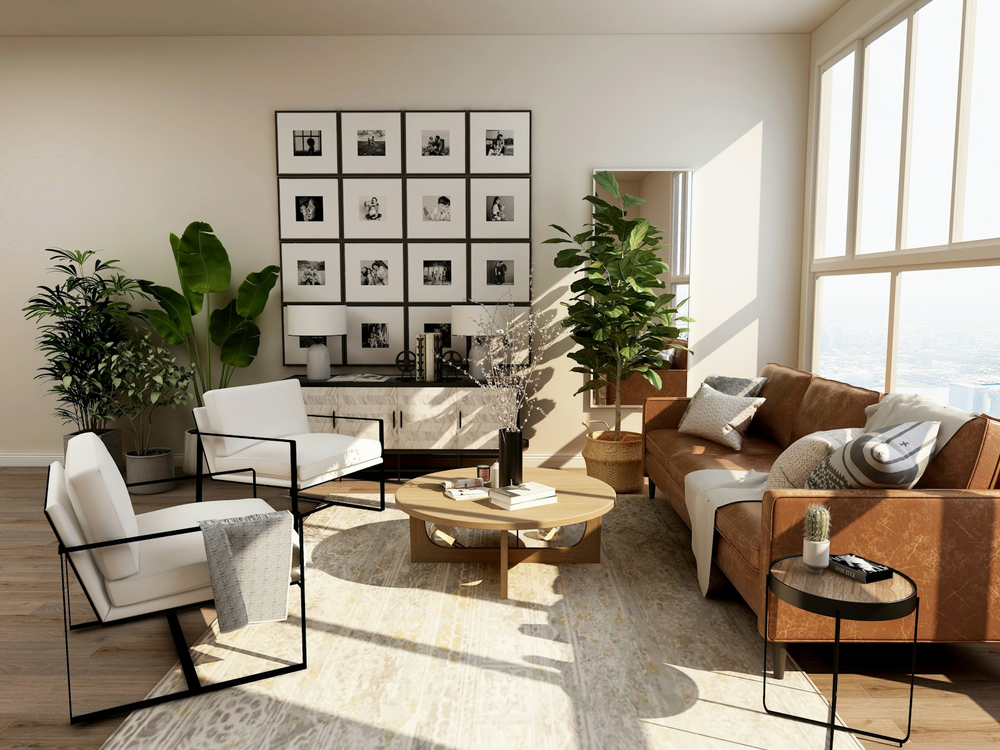

# Aura Architectural Atelier · 3D Luxury Interior Studio Website

An interactive, ultra-luxury 3D architectural interior design studio website crafted with **React**, **Three.js**, **Vite**, and **Lenis** smooth scrolling.



## ✨ Features

- **Interactive 3D Architectural WebGL Corridor (Three.js)**:
  - Custom extruded geometric 3D "A" monogram logo sculpture in brushed champagne and walnut bronze.
  - Architectural corridor featuring vertical American walnut louvers, smoked marble flooring with real-time reflections, recessed LED lighting, and ambient dust particles.
  - Floating 3D gallery frames featuring real high-resolution interior photography with dedicated overhead picture spotlights.
  - Camera travels down the corridor synchronized with scroll progress and subtle spring-damped mouse parallax.
- **Scroll-Driven Disciplines Walkthrough**:
  - Focuses on Residential Estates, Corporate Headquarters, Kitchen Architecture, and Turnkey Sanctuaries.
- **Interactive 3D Methodology Ring**:
  - 4-phase rotating process carousel (Blueprint, Sourcing, Joinery, Handover).
- **Philosophy / Promise Cards**:
  - 3D perspective tilt cards with mouse glare reflections and crisp white typography.
- **Interactive Consultation Atelier**:
  - Floating label contact inputs with automated WhatsApp routing and embedded Google Map.
- **Live Palette Theme Switcher**:
  - Floating widget supporting Walnut Champagne, Titanium Monochrome, Glacier Cyan, Royal Cobalt, and Precision Crimson.
- **Responsive & Accessible**:
  - Full-screen radial mobile drawer menu, custom spring-physics cursor with contextual labels, and responsive layout.

## 🎨 Color Palette

- **Deep Smoked Walnut Noir**: `#141210` / `#181513`
- **Brushed Champagne**: `#D6C2A5`
- **Rich American Walnut Timber**: `#795B43`
- **Pure Crisp White**: `#FFFFFF`
- **Warm Ivory**: `#F0EBE1` / `#F5F0E8`

## 🚀 Getting Started

### Prerequisites

- Node.js (v18 or higher recommended)
- npm or yarn / pnpm

### Installation

```bash
# Clone the repository
git clone https://github.com/Tamilselvan0298/3d-interior-website.git

# Navigate into project directory
cd 3d-interior-website

# Install dependencies
npm install

# Start local dev server
npm run dev
```

Visit `http://localhost:3000` to view the website in your browser.

### Build for Production

```bash
npm run build
```

The optimized static assets will be output to the `dist/` folder.

## 🛠️ Tech Stack

- **Framework**: React 18
- **Bundler**: Vite
- **3D Graphics**: Three.js
- **Smooth Scroll**: @studio-freight/lenis
- **Icons**: Lucide React
- **Typography**: Montserrat

## 📄 License

MIT License. Designed and developed for Aura Architectural Atelier.

